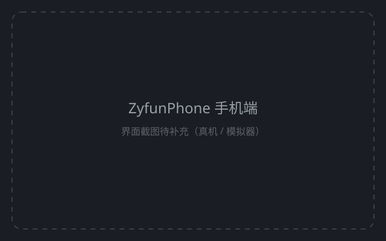
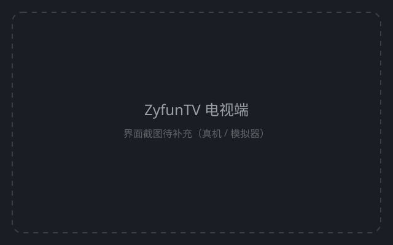
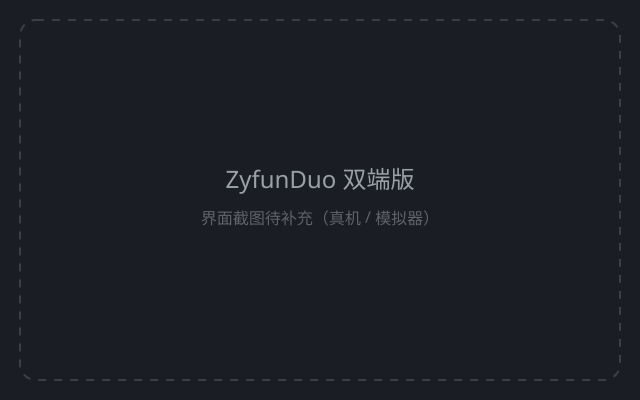

# zyfun-tv

A native **Kotlin + Jetpack Compose** Android client for TV and phones, reimplemented on Android following the protocols and data models of the upstream [Hiram-Wong/zyfun](https://github.com/Hiram-Wong/zyfun) (formerly ZyPlayer, an Electron + Vue3 + TypeScript cross-platform desktop player).

**Language:** [中文](README.md) | **English**

## Introduction

### Origin & Relationship

- **Upstream**: [Hiram-Wong/zyfun](https://github.com/Hiram-Wong/zyfun) (formerly ZyPlayer), a TypeScript + Electron + Vue3 cross-platform desktop video resource player, licensed under AGPL-3.0.
- **This project**: Not a code-level fork. It reuses the upstream site / live / parser / cloud-drive protocols and data models, reimplemented with a native Android stack; it is an AGPL-3.0 derivative of the upstream work.
- **Scope**: One codebase covering both TV (Leanback) and Phone, split into three product flavors.

### Languages & Tech Stack

- **Language**: Kotlin (all sources are `.kt`, no Java); Gradle build scripts use Groovy DSL (`.gradle`).
- **UI**: Jetpack Compose (Material3 + Compose for TV `tv-material`), zero XML layouts; independent themes, components and screens for TV and phone.
- **Player**: Media3 ExoPlayer 1.4.1 (HLS / DASH / MP4).
- **Storage**: Room 2.6.1 (KSP) + DataStore Preferences 1.1.1.
- **Network / Serialization / Image**: OkHttp 4.12.0, kotlinx-serialization-json 1.7.3, Coil 2.7.0.
- **Build**: JDK 17, AGP 8.7.3, compileSdk / targetSdk 35, minSdk 21, build-tools 36.0.0.

### Features

Modules aligned with upstream: film sites (film), live IPTV (live), link parsing (parse), moments / short drama (moment), lab (lab), settings (setting), player (player), in-app browser (WebView).

Android-side implementation and extensions:

- Dual-target UI: TV side navigation rail + phone bottom navigation, independent themes and components per target; `universal` adapts at runtime, `phone` / `tv` force the target form factor.
- Hot rankings: ranking feed fetch with search / parser fallback playback.
- Cloud drive: Alist adapter + WebDAV client, file-manager style browsing and playback.
- LAN sync: device discovery + client / server push between devices.
- Core utilities: deep-link launch, JS script execution, SM4 / AES / MAC crypto, web sniffing, TLS compatibility, in-app debug log panel, config backup / archive import.
- Multiple parser adapters: Catvod, AppYsV2, AppGet, Xbpq, Xyq, T0Xml, Xmltv, etc.

### Version

- Current: versionName `0.3.59`, versionCode `62` (internal build increment).
- First Release in this public repository: `v0.3.59`; earlier builds were local debug / release test packages and their history is not kept in this repository.

## Screenshots

> Placeholder screenshots; to be replaced with real UI captures after device / emulator verification.

| Phone ZyfunPhone | TV ZyfunTV | Dual ZyfunDuo |
| --- | --- | --- |
|  |  |  |

## Download

Signed APKs for the three flavors are attached to the Release (not committed to the source repository):

| Flavor | App name | applicationId | Target | Download |
| --- | --- | --- | --- | --- |
| `universal` | ZyfunDuo | `com.hoopoe.zyfun.duo` | Dual-target, runtime switch | [Releases](https://github.com/ballad0324/zyfun-tv/releases/latest) |
| `phone` | ZyfunPhone | `com.hoopoe.zyfun.phone` | Phone | [Releases](https://github.com/ballad0324/zyfun-tv/releases/latest) |
| `tv` | ZyfunTV | `com.hoopoe.zyfun.tv` | TV | [Releases](https://github.com/ballad0324/zyfun-tv/releases/latest) |

## Tech Baseline

| Item | Version / Path |
|---|---|
| Language | Kotlin 2.0.21 |
| UI | Jetpack Compose 1.7.3 + Compose for TV (`androidx.tv:tv-material:1.0.0`) |
| Build | Gradle 8.9 + AGP 8.7.3 |
| JDK | 17 |
| SDK | compileSdk 35 / minSdk 21 / targetSdk 35, build-tools 36.0.0 |
| Player | Media3 ExoPlayer 1.4.1 (HLS/DASH/MP4) |
| Storage | Room + DataStore Preferences 1.1.1 |
| Network/Serialization | OkHttp 4.12.0 + kotlinx-serialization-json 1.7.3 + Coil 2.7.0 |

- Code namespace: `com.hoopoe.zyfuntv`; the three flavor applicationIds are `com.hoopoe.zyfun.duo` (dual), `com.hoopoe.zyfun.phone` (phone), `com.hoopoe.zyfun.tv` (tv), configured in `productFlavors` of `app/build.gradle`.
- Repository mirrors: Aliyun public/central/google/releases/gradle-plugin + google()/mavenCentral() (see `settings.gradle`).

## Local Build (CLI)

Set `JAVA_HOME` (JDK 17) and `ANDROID_HOME` (Android SDK), then run with the local Gradle:

```powershell
$env:JAVA_HOME='<JDK17_HOME>'
$env:ANDROID_HOME='<ANDROID_SDK_HOME>'
$g='<GRADLE_BAT_OR_EXECUTABLE>'
& $g :app:dependencies --configuration debugCompileClasspath   # resolve dependencies only
& $g :app:assembleUniversalDebug                               # build debug APK (run only when explicitly requested)
```

Flavor build tasks: `assembleUniversalDebug` / `assemblePhoneDebug` / `assembleTvDebug`; release counterparts are `assemble<Flavor>Release`. The root-level `build-debug.ps1` / `build-release.ps1` / `verify-release.ps1` scripts batch build and verify; local environment paths in the scripts must be adjusted to your machine.

> Convention: after changing features, test on emulator / device first; do not package automatically. Build a release only when explicitly requested.

## Project Structure

```
app/src/main/java/com/hoopoe/zyfuntv/
├── MainActivity.kt
├── core/
│   ├── archive/        # config backup / archive import
│   ├── crypto/         # SM4 / AES / MAC crypto
│   ├── debug/          # in-app debug log collection
│   ├── deeplink/       # external link launch parsing
│   ├── model/          # enums and shared data models
│   ├── network/        # HTTP fetch, TLS compat, web sniffing
│   ├── notify/         # notifications
│   ├── player/         # external player intents
│   ├── script/         # JS script execution
│   ├── sync/           # LAN sync (discovery / client / server)
│   └── webdav/         # WebDAV client
├── data/
│   ├── local/          # Room entities / DAOs / database
│   ├── parser/         # site / live / parser / cloud-drive adapters
│   ├── prefs/          # DataStore settings
│   ├── remote/model/   # CMS / TVBox serialization models
│   └── repository/     # repository and config import
├── player/             # ExoPlayer controller and Compose view
└── ui/
    ├── App.kt          # dual-target adaptive root shell
    ├── nav/            # destination definitions
    ├── component/      # mobile / tv components
    ├── screens/        # mobile / tv screens
    └── theme/          # mobile / tv themes (color / shape / type / size)
```

UI mode: `UiMode` (auto/phone/tv) persisted in DataStore, default phone; the `universal` flavor adapts at runtime, while `phone` / `tv` force the target form factor via `FORCED_UI_MODE`.

Independent themes per target: `ui/theme/mobile` and `ui/theme/tv`; screens and components are split under `ui/screens/mobile`, `ui/screens/tv`, `ui/component/mobile`, `ui/component/tv`.

## License

This project is a derivative of [Hiram-Wong/zyfun](https://github.com/Hiram-Wong/zyfun), open-sourced under **AGPL-3.0**; see [LICENSE](LICENSE) for the full text. When distributing derivative versions, retain this license and open-source the source under the same terms.
