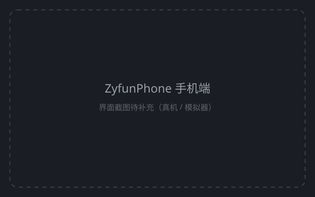
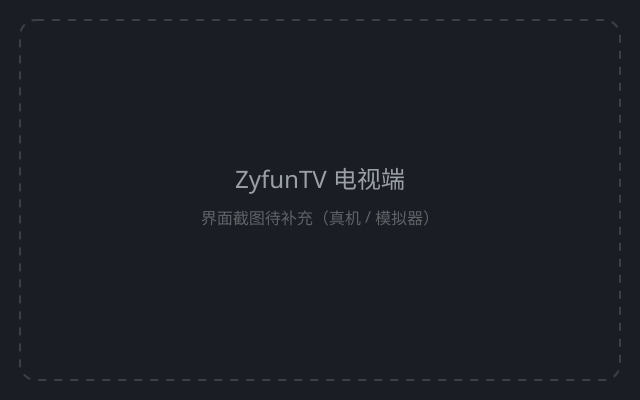
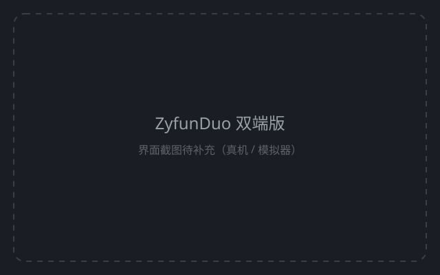

# zyfun-tv

基于 zyfun（Hiram-Wong/ZyPlayer）协议与数据模型重写的 **原生 Kotlin Android TV / 手机双端客户端**。

## 界面预览

> 截图为占位，待真机 / 模拟器验证后替换为实际界面图。

| 手机端 ZyfunPhone | 电视端 ZyfunTV | 双端版 ZyfunDuo |
| --- | --- | --- |
|  |  |  |

## 下载

Release 附件提供三个变体的签名 APK（不随源码仓库提交）：

| 变体 | 应用名 | applicationId | 适用端 | 下载 |
| --- | --- | --- | --- | --- |
| `universal` | ZyfunDuo | `com.hoopoe.zyfun.duo` | 双端合一，运行时切换 | [Releases](https://github.com/ballad0324/zyfun-tv/releases/latest) |
| `phone` | ZyfunPhone | `com.hoopoe.zyfun.phone` | 手机端 | [Releases](https://github.com/ballad0324/zyfun-tv/releases/latest) |
| `tv` | ZyfunTV | `com.hoopoe.zyfun.tv` | 电视端 | [Releases](https://github.com/ballad0324/zyfun-tv/releases/latest) |

## 技术基线

| 项 | 版本 / 路径 |
|---|---|
| 语言 | Kotlin 2.0.21 |
| UI | Jetpack Compose 1.7.3 + Compose for TV (`androidx.tv:tv-material:1.0.0`) |
| 构建 | Gradle 8.9 + AGP 8.7.3 |
| JDK | 17 |
| SDK | compileSdk 35 / minSdk 21 / targetSdk 35，build-tools 36.0.0 |
| 播放器 | Media3 ExoPlayer 1.4.1（HLS/DASH/MP4） |
| 存储 | Room + DataStore Preferences 1.1.1 |
| 网络/序列化 | OkHttp 4.12.0 + kotlinx-serialization-json 1.7.3 + Coil 2.7.0 |

- 代码 namespace：`com.hoopoe.zyfuntv`；三产品变体 applicationId 分别为 `com.hoopoe.zyfun.duo`（双端）、`com.hoopoe.zyfun.phone`（手机）、`com.hoopoe.zyfun.tv`（电视），在 `app/build.gradle` 的 productFlavors 中配置。
- 仓库镜像：阿里云 public/central/google/releases/gradle-plugin + google()/mavenCentral()（见 `settings.gradle`）。

## 本机构建（命令行）

先设置 `JAVA_HOME`（JDK 17）与 `ANDROID_HOME`（Android SDK），再用本机 gradle 执行：

```powershell
$env:JAVA_HOME='<JDK17_HOME>'
$env:ANDROID_HOME='<ANDROID_SDK_HOME>'
$g='<GRADLE_BAT_OR_EXECUTABLE>'
& $g :app:dependencies --configuration debugCompileClasspath   # 仅解析依赖
& $g :app:assembleUniversalDebug                               # 出 debug APK（需明确要求时再跑）
```

三变体构建任务：`assembleUniversalDebug` / `assemblePhoneDebug` / `assembleTvDebug`，release 对应 `assemble<Flavor>Release`。根目录 `build-debug.ps1` / `build-release.ps1` / `verify-release.ps1` 可批量构建与校验，脚本内环境路径需按本机实际填写。

> 约定：改完功能先在模拟器/真机测试，不自动打包；仅在明确要求时构建版本。

## 目录结构

```
app/src/main/java/com/hoopoe/zyfuntv/
├── MainActivity.kt
├── core/
│   ├── archive/        # 配置备份 / 归档导入
│   ├── crypto/         # SM4 / AES / MAC 加解密
│   ├── debug/          # 屏内调试日志采集
│   ├── deeplink/       # 外部链接唤起解析
│   ├── model/          # 枚举与共享数据模型
│   ├── network/        # HTTP 抓取、TLS 兼容、网页嗅探
│   ├── notify/         # 通知
│   ├── player/         # 播放器外部意图
│   ├── script/         # JS 脚本执行
│   ├── sync/           # 局域网同步（设备探测 / 客户端 / 服务端）
│   └── webdav/         # WebDAV 客户端
├── data/
│   ├── local/          # Room 实体 / DAO / 数据库
│   ├── parser/         # 站点 / 直播 / 解析 / 网盘等适配器
│   ├── prefs/          # DataStore 设置
│   ├── remote/model/   # CMS / TVBox 序列化模型
│   └── repository/     # 仓库与配置导入
├── player/             # ExoPlayer 控制器与 Compose 视图
└── ui/
    ├── App.kt          # 双端自适应根壳
    ├── nav/            # 目的地定义
    ├── component/      # mobile / tv 双端组件
    ├── screens/        # mobile / tv 双端页面
    └── theme/          # mobile / tv 双端主题（色 / 形 / 字 / 尺寸）
```

界面模式：`UiMode`（auto/phone/tv）持久化于 DataStore，默认手机端；`universal` 变体运行时自适应，`phone` / `tv` 变体经 `FORCED_UI_MODE` 强制对应端型。

双端各自独立主题：`ui/theme/mobile` 与 `ui/theme/tv`；页面与组件按 `ui/screens/mobile`、`ui/screens/tv`、`ui/component/mobile`、`ui/component/tv` 拆分。

## 许可

本项目为 zyfun（Hiram-Wong/ZyPlayer）的衍生作品，依 **AGPL-3.0** 协议开源，全文见 [LICENSE](LICENSE)；对外分发衍生版本时需保留本许可并以相同协议开放源码。
